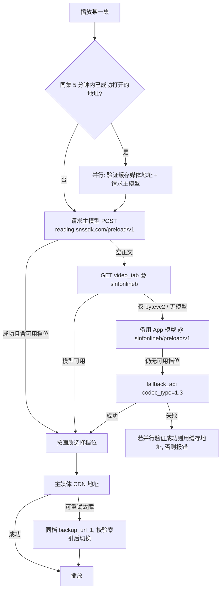

# 红果 TV 播放源地址说明（0.16.10 → 0.16.14）

本文基于仓库提交记录整理，范围是 `kotlin-v0.16.10` 到 `kotlin-v0.16.14` 之间与**播放源地址**有关的改动。`0.16.10` 作为基线，`0.16.11`～`0.16.14` 为四个发布版本。

## 1. 结论摘要

播放"源地址"分为两层，四个版本的主要变化也分别发生在这两层：

| 层级 | 内容 | 0.16.10 基线 | 0.16.14 现状 |
| --- | --- | --- | --- |
| 模型地址 | 取播放模型（片源清单）的 HTTP 接口 | 主：`POST https://api5-normal-sinfonlinea.fqnovel.com/novel/player/multi_video_model/player/v1` | 主：`POST https://reading.snssdk.com/novel/player/multi_video_model/preload/v1` |
| | 备用接口 | `GET https://api5-normal-sinfonlineb.fqnovel.com/reading/bookapi/video_tab/multi_video_model/v1/`（旧签名） | 同路径 GET，v5 签名、74532 参数 |
| | 编码兜底 | 无 | 模型内 `fallback_api`，按 `codec_type=1`、`3` 协商 |
| 媒体地址 | 实际下载播放的 MP4/CDN 地址 | 按 `main_url` → `play_url` → `backup_url_1` 取单一地址 | 同上，并保留 `backup_url_1` 作为运行期同档备用 CDN |
| | 地址失效处理 | 重新取模型或报错 | 同集近期地址复用、同档备用 CDN 切换、索引一致性校验 |

一句话概括：**0.16.11 解决"媒体 CDN 地址不稳定/换集抖动"，0.16.12 修正备用模型 GET 的签名与地址形态，0.16.13 增加备用模型域名回退，0.16.14 切换到当前 App 协议的主地址并用纯 Kotlin 签名恢复取流。**

## 2. 版本与提交对应

| 版本 | versionCode | 标签 | 播放源地址相关提交 |
| --- | --- | --- | --- |
| 0.16.10 | 31 | `kotlin-v0.16.10` | 基线，无新增播放地址改动 |
| 0.16.11 | 32 | `kotlin-v0.16.11` | `03bca24`、`06b2ffe`、`73e7e8d`、`75e90fc`、`bedaf12`、`3245916`、`0646a06`、`acc2bdd` |
| 0.16.12 | 33 | `kotlin-v0.16.12` | `1782dda` |
| 0.16.13 | 34 | `kotlin-v0.16.13` | `ac3a1e2` |
| 0.16.14 | 35 | `kotlin-v0.16.14` | `ef328f3` |
| 0.16.14.1 | 35（同一 0.16.14 版本号） | `kotlin-v0.16.14.1` | `04caad7`，仅电视端宽版横幅 UI，不涉及播放源 |

## 3. 0.16.10 基线

### 3.1 主模型地址

- 方法：`POST`
- 地址：`https://api5-normal-sinfonlinea.fqnovel.com/novel/player/multi_video_model/player/v1`
- 公共参数：`aid=8662`、`app_name=novelread`、`version_code=74332`、`version_name=7.4.3.32`、`channel=vivo_8662_64`、`device_type=PGT-AN10`、`os_version=12`
- 请求体：gzip 压缩的 JSON，`biz_param.device_level=1`、`dr_scene=player`
- 签名：V5 签名；`x-ss-stub` 为 gzip 正文字节的 MD5
- 媒体服务器偏好：`video_platform=1024`

### 3.2 备用模型地址

主接口返回空正文时，走 `GET https://api5-normal-sinfonlineb.fqnovel.com/reading/bookapi/video_tab/multi_video_model/v1/`。该路径本身是官方 App 的 `video_tab` 取址接口，但 0.16.10 使用的是旧版本参数与签名形态（73932）。

### 3.3 媒体地址

从模型 `video_list` 读取 `main_url`、`play_url`、`backup_url_1`，按该顺序取第一个可用值作为唯一播放地址。`backup_url_1` 当时只是"前两个地址都缺失时的兜底"，没有运行期故障切换能力。媒体 URL 可能在模型中以明文、Base64 或 `key_seed` 加密形式出现。

## 4. 0.16.11：媒体地址与换集恢复

本版本没有更换模型接口域名，重点是把"已经拿到的媒体地址"用稳。

| 提交 | 行为变化 |
| --- | --- |
| `75e90fc` | 新增 `PlaybackSourceCache`：按分集 ID 缓存最近成功打开的 `Rendition`（含媒体 URL），TTL 5 分钟、最多 6 条。模型临时空响应时，可复用该地址，但必须在 2 秒内重新发起媒体请求验证。 |
| `3245916` | 主接口空包后，**并行**验证同集缓存片源与请求备用模型；`streamLadderWithCompatibility` 新增 `onPrimaryEmpty` 回调，把缓存验证提前到等待备用接口期间。 |
| `0646a06` | 解析并保存同一档位的 `backup_url_1`，新增 CDN 故障切换：仅当 5xx（无 `Retry-After`）、Socket 超时或请求超时等"可重试"错误时，切换到备用地址；切换前校验备用地址的 MP4 索引与当前已准备流完全一致；每路流只允许一次备用尝试。 |
| `acc2bdd` | 缓存按"请求的最高画质"隔离，避免更换画质设置后误用其他档位；同一画质设置下允许复用略高于上限的已验证兼容档。 |
| `06b2ffe` | 新增 `RemoteVideo.PreparedSource`，从首页"随心看"进入全集时，可把已准备完成的同集片源直接交给播放器，避免重新取址。 |
| `bedaf12` | 缩短换集预加载等待，`PreparedSlot` 增加 ticket 版本校验，保留当前集档位，防止过期预取被误用。 |
| `73e7e8d` | 主模型空响应后 5 秒内暂停后台预取，减少对空响应的放大；播放信息校验改为按需刷新。 |
| `03bca24` | 主、备模型都为空时，把 `allPlaybackModelsEmpty` 传递给恢复预算，继续自动恢复而不是立即终止。 |

### 4.1 CDN 切换规则（0.16.11 起保持）

```
主媒体地址请求
  ├─ 成功：继续播放
  └─ 可重试错误（5xx 无 Retry-After / 超时 / 超时中断）
       ├─ 存在 backup_url_1 且与主地址不同
       │    ├─ 已准备流：4 秒内读取备用地址 MP4 头，索引必须逐字节一致
       │    └─ 校验通过：切换 info.url 到备用地址，后续 Range 请求走新地址
       └─ 无备用或校验失败：抛错，不无限重试
```

不可重试错误（如普通 4xx）不切换备用地址，避免把"资源已变化/无权限"误判成 CDN 故障。

## 5. 0.16.12：备用模型 GET 的签名修正

提交 `1782dda` 修复 issue #83：主接口返回 `HTTP 200 / 0B` 后，备用 `video_tab` GET 也需要 v5 签名。

- 地址不变：`GET https://api5-normal-sinfonlineb.fqnovel.com/reading/bookapi/video_tab/multi_video_model/v1/`
- 参数仍是 74332 / 7.4.3.32 形态
- 签名输入使用**空字节**（不是零值摘要），并保留 `MD5(empty)` 语义
- 请求头使用移动端 UA：
  `com.phoenix.read/73932 (Linux; U; Android 16; zh_CN; 25053RT47C; Build/BP2A.250605.031.A3; Cronet/...)`
- 因为是 GET，签名器生成的 `x-ss-stub`、`Content-Type`、`Content-Encoding` 会被移除
- 新增 `tabVideoModel(..., mobileV5 = true)` 开关，仅备用路径启用

该版本还保留了主接口空响应时的诊断信息（HTTP 状态、读取字节数），但不会把完整地址或签名写入日志。

## 6. 0.16.13：备用模型域名回退

提交 `ac3a1e2` 修复 issue #93：`video_tab` 返回的模型只有 `bytevc2` 时（电视端解码器不支持，过滤后为空），改为复用同一匿名会话，向备用 App 域名再请求一次播放模型。

- 新增 `MobilePlayback.ladder(..., host: String)` 参数
- 回退地址：`https://api5-normal-sinfonlineb.fqnovel.com/novel/player/multi_video_model/player/v1`
  （0.16.13 仍为 `player/v1`，因为当时尚未启用 74532 当前 App 协议）
- 使用同一 `profile.values` 与同一签名器，不重新注册设备
- 若备用域名仍返回空正文，错误链中附带 `video-tab-empty` / `video-tab-no-model` 诊断

## 7. 0.16.14：切换当前 App 协议主地址（纯 Kotlin 取流）

提交 `ef328f3` 修复 issue #102。真实播放路径改为当前 App 的 7.4.5.32 协议，且不依赖原生 `.so`。

### 7.1 主模型地址变化

| 项 | 0.16.13 及以前 | 0.16.14 |
| --- | --- | --- |
| 主机 | `api5-normal-sinfonlinea.fqnovel.com` | `reading.snssdk.com` |
| 路径 | `/novel/player/multi_video_model/player/v1` | `/novel/player/multi_video_model/preload/v1` |
| 版本参数 | 74332 / 7.4.3.32 | 74532 / 7.4.5.32 |
| `channel` | `vivo_8662_64` | `update_64` |
| 设备描述 | `PGT-AN10` / Android 12 | `25053RT47C` / Redmi / Android 16 / `os_api=36` |
| 请求体 | `device_level=1`、`dr_scene=player` | `device_level=2`、`dr_scene=preload` |
| UA | `com.phoenix.read/73932 ...` | `System.getProperty("http.agent")`（设备默认 UA） |

签名侧的关键修正：

- `V5Constants.field21` 由 `377` 改为 `312`（Medusa 第 21 字段）。同一请求逐字段 A/B 中，`377` 返回 `200/0B`，`312` 恢复模型返回。
- `MobilePlayback.signer` 标记 `currentAppProtocol = true`，模型 GET/POST 统一使用 74532 参数集。
- 签名器仍对实际发送的 gzip 正文字节签名，不复制任何 App 会话。

### 7.2 备用模型地址

- `video_tab` 备用路径仍为 `https://api5-normal-sinfonlineb.fqnovel.com/reading/bookapi/video_tab/multi_video_model/v1/`，但参数和签名已跟随 74532 当前 App 协议。
- 当 `video_tab` 模型过滤后为空，备用 App 模型地址变为：
  `https://api5-normal-sinfonlineb.fqnovel.com/novel/player/multi_video_model/preload/v1`
  （显式传入的备用主机仍生效；0.16.14 修正了旧实现固定主机导致备用请求落回原主机的问题）

### 7.3 编码兜底地址（fallback_api）

当前 App 模型可能只返回 `bytevc2`。0.16.14 在过滤后为空时：

1. 读取模型中的 `fallback_api`（支持字符串、对象、数组三种形态，必须是 HTTPS）；
2. 依次请求 `codec_type=1`、`codec_type=3`；
3. 从返回的 `video_info.data` 中重新解析 `video_list`；
4. 该请求使用独立 `NO_COOKIES` 传输，不带签名头、账户 Cookie，也不访问官网播放器。

### 7.4 地址选择总时序



## 8. 当前地址清单（0.16.14）

| 用途 | 方法 | 地址 | 关键参数/说明 |
| --- | --- | --- | --- |
| 主播放模型 | POST | `https://reading.snssdk.com/novel/player/multi_video_model/preload/v1` | 74532、`device_level=2`、`dr_scene=preload`、V5 签名 |
| 备用播放模型（TV 常规） | GET | `https://api5-normal-sinfonlineb.fqnovel.com/reading/bookapi/video_tab/multi_video_model/v1/` | 74532 参数、空字节 V5 签名 |
| 备用播放模型（编码回退） | POST | `https://api5-normal-sinfonlineb.fqnovel.com/novel/player/multi_video_model/preload/v1` | 同一匿名设备会话；仅当 `video_tab` 无可用档位 |
| VOD 编码协商 | GET | 模型 `fallback_api` 字段提供的 HTTPS 地址 | `codec_type=1`、`3`；无签名头、无账号 Cookie |
| 媒体主地址 | GET Range | 模型 `main_url` / `play_url` | 需 `Range`、`Referer: https://novel.snssdk.com/`、视频 UA |
| 媒体备用地址 | GET Range | 模型 `backup_url_1` | 与主地址同档位；索引一致才切换 |

域名候选表（`PlayRetryPlan`，用于备用域名选择和诊断代号）：

| 域名 | 诊断代号 |
| --- | --- |
| `api5-normal-sinfonlineb.fqnovel.com` | `b` |
| `api5-normal-hl.fqnovel.com` | `hl` |
| `api5-normal-lf.fqnovel.com` | `lf` |

注意：媒体 CDN 域名由模型动态下发，不是固定域名；代码中不硬编码 CDN 主机。

## 9. 媒体地址解析与播放

1. 遍历模型 `video_list`；
2. 过滤 `codec_type` / `gear_des_key` / `video_meta.codec_type` 中含 `bytevc2` 或 `bvc2` 的档位（电视端平台解码器不支持）；
3. 解析 `main_url`、`play_url`、`backup_url_1`：
   - 先按普通 URL 校验（必须是 HTTPS、无用户名密码）；
   - 失败则用模型 `key_seed` 解密，或按 Base64 解码；
4. `main_url` 或 `play_url` 作为主地址；`backup_url_1` 作为同档位备用地址（与主地址相同时不重复保存）；
5. 加密内容使用 `spade_a` 派生密钥，播放时按 MP4 样本解密；
6. 每次 Range 请求携带 `Range`、视频 UA、`Referer`。

## 10. 质量档位与地址的关系

- 用户画质上限 `maxQuality` 参与档位选择：优先不超过上限的最高档；都超过时退到最低档并标注"兼容资源"。
- 选择顺序为"最佳档位优先，再按同档及更低档降级"，每一档都先校验 MP4 头与解码能力。
- 同集地址缓存同时记录"请求时的画质上限"，避免在用户改画质后复用不匹配档位；若该集只有高于上限的兼容档，允许在原上限一致时复用。
- 空模型后 5 秒内暂停后台预取，避免反复请求同一空地址。
- 自动恢复预算：快段 3 次（1s、2.5s、5s），慢段 5 次（15s、30s、60s、90s、105s）；手动重试重置预算。

## 11. 超时、取消与诊断

| 阶段 | 预算 |
| --- | --- |
| 前景取模型 | 8 秒 |
| 后台/预取取模型 | 2 秒 |
| 缓存片源重新验证 | 2 秒 |
| 备用 CDN 索引校验 | 4 秒 |
| 播放模型响应体上限 | 2 MiB |

- 所有请求共享 `RequestScope` 绝对截止时间，嵌套调用不能延长预算；取消会中断正在读取的媒体流。
- 日志和界面只展示错误类别（超时、域名解析失败、分段断开、空响应、地址格式异常等）与阶段代号，不输出媒体地址、查询凭据或完整签名。
- 诊断代号示例：`mobile-model=200/0B`、`video-tab-empty`、`video-tab-no-model`、`video-tab-no-compatible-source`、`recent-source=unavailable`。

## 12. 相关代码与文档

| 内容 | 路径 |
| --- | --- |
| 主/备模型请求、VOD 编码回退 | [MobilePlayback.kt](kotlin-tv/core/src/main/kotlin/com/hongguotv/core/MobilePlayback.kt) |
| 取模顺序、备用域名、恢复回调 | [ContentRepository.kt](kotlin-tv/core/src/main/kotlin/com/hongguotv/core/ContentRepository.kt#L975-L1036) |
| 模型解析、URL 解码、bytevc2 过滤 | [PlaybackModels.kt](kotlin-tv/core/src/main/kotlin/com/hongguotv/core/PlaybackModels.kt) |
| 媒体 Range、备用 CDN 切换 | [RemoteVideo.kt](kotlin-tv/core/src/main/kotlin/com/hongguotv/core/RemoteVideo.kt) |
| 同集地址缓存与并行验证 | [PlaybackSources.kt](kotlin-tv/app/src/main/kotlin/com/hongguotv/nativeapp/PlaybackSources.kt) |
| 备用域名与诊断代号 | [PlayRetry.kt](kotlin-tv/core/src/main/kotlin/com/hongguotv/core/PlayRetry.kt) |
| V5 签名与 F21 常量 | [Signer.kt](kotlin-tv/core/src/main/kotlin/com/hongguotv/core/Signer.kt)、[V5Constants.kt](kotlin-tv/core/src/main/kotlin/com/hongguotv/core/V5Constants.kt) |
| Issue #102 取流调查与验收 | [2026-11-23-issue102-nonweb-playback.md](docs/research/2026-11-23-issue102-nonweb-playback.md) |
| 0.16.12 发布说明 | [RELEASE_0.16.12.md](kotlin-tv/RELEASE_0.16.12.md) |
| 0.16.13 发布说明 | [RELEASE_0.16.13.md](kotlin-tv/RELEASE_0.16.13.md) |

## 13. 边界与风险

- 上游 App 协议、签名规则和模型接口可用性可能继续变化；`312` 是当前样本验证值，不保证长期有效。
- `reading.snssdk.com` 与 `api5-normal-*` 主机的可用性、限流策略可能不同，代码保留了备用主机回退但不会无限轮换。
- 媒体 CDN 地址由模型动态下发，有效期短；缓存仅 5 分钟且必须重新验证，不能当作长期地址保存。
- 备用 CDN 只在明确的可重试错误下切换，且一次播放流只尝试一次，避免在地址失效时造成重复下载。
- 0.16.14 的真实播放验收覆盖 ARM64 Android TV 模拟器与 Android 6/API 23 ARM64 模拟器；ARM32、Android 5、实体电视和长时间稳定性仍需单独验收。
